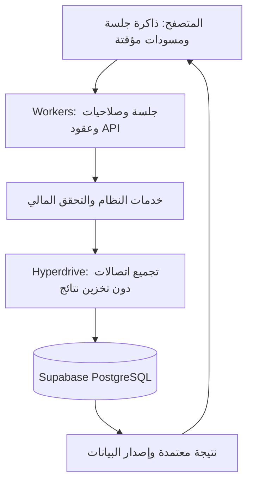

# خطة جلب البيانات وحفظها وتعديلها على Cloudflare وSupabase

تاريخ الدراسة: 29 أكتوبر 2026. الحالة: **نُفذت في الكود واختُبرت محليًا؛ لم تُنشر إلى Cloudflare ولم تُطبق على قاعدة الإنتاج**. هذه الدراسة تصف نقطة البداية والقرارات؛ النتيجة وحدود التحقق في [تقرير التنفيذ](CLOUDFLARE-IMPLEMENTATION-REPORT.md)، والتشغيل في [دليل النشر](CLOUDFLARE-DEPLOYMENT.md).

## 1. نطاق الدراسة والقرارات

الهدف: تنقل سريع، وقراءات مالية متسقة، وحفظ موثوق عند التزامن أو انقطاع الرد، دون كشف البيانات أو تغيير قواعد المحاسبة لتحسين السرعة. تبقى Supabase PostgreSQL مصدر الحقيقة، وتبقى الصلاحيات والتحقق في خادم التطبيق.

رابط لوحة Cloudflare يحدد حساب الاستضافة المطلوب، لكنه لا يثبت نوع الخطة أو المنطقة أو الموارد المتاحة. لم أفتح الحساب الخاص أو أغيّر موارده. يلزم حصر حدود الخطة والدومين ومنطقة Supabase الفعلية في مرحلة التهيئة؛ لا تُفترض منطقة جغرافية من عنوان المشروع.

المسار المستهدف: **Cloudflare Workers لتطبيق Next.js الديناميكي، وHyperdrive للاتصال بـSupabase، وذاكرة جلسة في المتصفح للعرض**. تشغيل Docker الحالي ليس ملفًا يمكن رفعه مباشرة إلى Workers. لا نحتاج نقل البيانات إلى D1 أو تحويل المتصفح إلى عميل مباشر لجداول Supabase.

Cloudflare توثق حاليًا vinext للمشروعات الجديدة وOpenNext لمسار توافق تطبيقات Next.js. لا يُختار محول نهائي قبل تجربة الإصدار الموجود والميزات المستخدمة. تعطيل تخزين الاستعلامات في Hyperdrive يُبقي ميزة تجميع الاتصالات متاحة. [Next.js/OpenNext](https://developers.cloudflare.com/workers/framework-guides/web-apps/opennext/)، [Hyperdrive caching](https://developers.cloudflare.com/hyperdrive/concepts/query-caching/).

## 2. ما ثبت من الكود الحالي

| المسار | الموجود | المطلوب |
|---|---|---|
| `package.json` و`Dockerfile` | Next.js 16.4.3، React 19.3.1، Prisma 5.22، تشغيل Node في Docker | اختبار توافق Workers وتثبيت إصدارات المحول والسائق؛ لا نفترض عمل محرك Prisma الحالي عليه |
| `src/lib/db.ts` | معاملات مالية مع قفل PostgreSQL؛ قراءة Repeatable Read؛ عملاء اتصال وطابور كتابة عامون | إبقاء سلامة المعاملة والقفل، وتحويل اتصالات Workers إلى نطاق الطلب |
| `src/lib/snapshot-cache.ts` | ذاكرة محدودة مبنية على لقطة PostgreSQL، وتتشارك Promises بين الطلبات | منع مشاركة I/O والوعود المرتبطة بطلب عبر Workers؛ بدء التنفيذ بذاكرة داخل الطلب |
| `src/services/costing-projection.ts` | تجميع قراءات التقرير في استعلام واحد وحماية Decimal أثناء JSON | الحفاظ على هذا التحسين وفحوص تطابقه |
| صفحات التقارير والمبيعات والأصناف | جلب يدوي متكرر، وحالة تحميل تحجب المحتوى في بعض الصفحات | طبقة طلبات وذاكرة مركزية وحالات تحديث غير حاجبة |
| `src/lib/api-guard.ts` | تحقق صلاحيات، ومعاملات، وIdempotency اختياري محفوظ في AuditLog | عقد موحد لمنع التكرار، ومفتاح فريد على مستوى قاعدة البيانات، وسياسة إعادة محاولة |
| `sales/new` وعدة نماذج أخرى | ترسل بالفعل Idempotency-Key | تعميم التغطية على بقية الأوامر؛ لا يُعاد تنفيذ الآلية من الصفر |
| `master.service.ts` وتعديلات الأطراف | تحديث بالمعرف مع سجل تدقيق؛ لم تظهر مقارنة إصدار للسجل في المسار المراجع | منع أن يمحو موظف تعديل موظف آخر بصمت |
| `login-limit.ts` | عداد ذري داخل PostgreSQL | الاحتفاظ بالتنسيق عبر قاعدة البيانات، لا استبداله بعداد ذاكرة Worker |
| النسخ والاستيراد | JSON/XLSX ومعالجة خادمية؛ أدوات pg_dump محلية | فصل المهام الثقيلة وأدوات PostgreSQL عن طلب المستخدم في Workers |

القياسات السابقة المحلية: رحلة قاعدة البيانات نحو 250ms؛ محرك التقرير البارد انخفض من نحو 9.97ث إلى 3.13ث، وطلب HTTP الفعلي بلغ نحو 4.03ث. هذه قياسات محدودة للبنية الحالية وليست نتائج لاستضافة Cloudflare. نجحت 41 حالة مرتبطة بتحسين التقرير؛ لا تمثل اختبار توافق Workers.

## 3. المرحلة الأولى — إثبات التوافق قبل إعادة البناء

**المخرجات:** بيئة staging منفصلة، وقرار موثق بالمحول والسائق والإصدارات المثبتة.

1. تجربة تسجيل الدخول، وكوكي الجلسة، وRoute Handler، وSSR، وAsyncLocalStorage، والمعاملة التفاعلية، وDecimal، وقراءة بيانات Prisma DMMF المستخدمة في الإسقاطات، داخل runtime الفعلي لـWorkers.
2. اختيار مسار Prisma يدعم Workers وسائق PostgreSQL المتوافق مع Hyperdrive. ترقية Prisma عند الحاجة كتغيير مستقل مع فحص التواريخ والدقة وSQL الخام والترحيلات. لا توجد ضرورة لترقية بقية المكتبات بلا سبب.
3. إعادة تشكيل `db.ts` بحيث يملك كل طلب عميله وسياق معاملته، ويُغلق الاتصال بطريقة السائق المعتمدة. لا يبقى اتصال شبكي أو Promise لطابور كتابة مشترك بين الطلبات. القفل الذري في PostgreSQL يبقى المنسق بين النسخ.
4. فحص حدود CPU والذاكرة وحجم الحزمة ومدة/حجم الطلب في خطة Cloudflare المختارة، خصوصًا XLSX والتكلفة والتشفير. وجود nodejs_compat لا يثبت توافق كل مكتبة أو تشغيل child_process/pg_dump.
5. تجربة placement بالاعتماد على منطقة القاعدة الفعلية والقياس. Workers لا يعني تلقائيًا أن كود التقرير سيعمل بجوار قاعدة البيانات.
6. إذا لم يتحقق التوافق ضمن تغيير محدود: يكون البديل الموثق خادم Node قريبًا من Supabase خلف Cloudflare، أو فصل خدمة الأعمال الثقيلة عنه؛ لا تُختزل معاملات المحاسبة للتغلب على قيود المنصة.

**قبول المرحلة:** دخول وقراءة وحفظ ثم rollback ناجحة في staging، دون تسريب سياق بين طلبين، ومع إثبات توافق المكتبات وحدود الموارد. لا تغيير في قاعدة العمل.

مراجع: [دورة اتصال Hyperdrive](https://developers.cloudflare.com/hyperdrive/concepts/connection-lifecycle/)، [Prisma وWorkers](https://www.prisma.io/docs/guides/deployment/cloudflare-workers)، [Placement](https://developers.cloudflare.com/workers/configuration/placement/).

## 4. المرحلة الثانية — عقود القراءة وطبقة طلبات واحدة

**الملفات المستهدفة:** `src/lib/api-guard.ts`، مسارات API، وطبقة عميل جديدة `src/lib/client-api.ts`.

- توحيد نجاح الطلب إلى بيانات وmetadata عند الحاجة، وتوحيد الأخطاء إلى code ورسالة محلية وrequestId وأخطاء الحقول. تطبيق تدريجي مع تكييف المستهلكين؛ لا كسر لجميع الصفحات دفعة واحدة.
- حالات واضحة: 401 انتهاء الجلسة، 403 منع صلاحية، 409 تعارض إصدار/عملية، 422 أخطاء حقول، 429 تهدئة، 5xx عطل عابر. فشل الشبكة لا يُصنف تلقائيًا رفضًا للعملية المالية.
- الوقت المستغرق وعدد الاستعلامات وحجم الرد ووقت انتظار القفل تُقاس بمعرف الطلب؛ لا تُسجل كلمات المرور أو الكوكيز أو أجسام السندات.
- قوائم الاختيار تستخدم lookup محدودًا؛ لا يُحمل المخزون وتكلفته بالكامل لاختيار صنف. البحث على الخادم بتأخير قصير وإلغاء الطلب السابق، وصفحات محدودة وترتيب ثابت. يُستخدم cursor عند ثبوت فائدة للقوائم الكبيرة، مع بقاء صفحة المبيعات الحالية المحدودة حتى ذلك الوقت.
- قراءات التقرير المترابطة في لقطة واحدة. التوازي للطلبات المستقلة فقط؛ Promise.all على اتصال معاملة واحدة لا يجعل SQL متوازيًا.
- أموال وكميات ذات أربع منازل تصل في العقود الجديدة كنصوص عشرية محددة، وتُحسب بـDecimal؛ يُراجع المستهلك قبل تبديل العقود الرقمية الحالية لتجنب فقد دقة حدود القيم.
- بيانات المستخدم المالية: `Cache-Control: private, no-store` على الردود الحساسة ومنع CDN من تخزين API أو HTML المصادق عليه. تُخزن الأصول الثابتة ذات أسماء المحتوى عبر CDN. ذاكرة JavaScript المقصودة تُدار منفصلة عن HTTP cache.

**قبول المرحلة:** نتائج البيانات مساوية للمرجع الحالي، بحث سريع لا يعرض ردًا قديمًا فوق رد جديد، وعدم تقديم تقرير أو حقول تكلفة إلى حساب غير مخول.

## 5. المرحلة الثالثة — ذاكرة جلسة المتصفح والتحديث

**القرار:** SWR واحد داخل المزود المصادق عليه؛ لا مزج أكثر من مكتبة كاش ولا بناء مدير كاش مالي مخصص دون ضرورة.

- المفتاح: نطاق المستخدم، إصدار الصلاحيات، اسم المورد، معرف السجل، الفترة والفلاتر والصفحة بعد تطبيعها. لا تتشارك فترتان أو حسابان نفس الرد.
- الكاش في الذاكرة أثناء الجلسة؛ حفظ التفضيلات البسيطة فقط على القرص. لا حفظ دائم للأرصدة أو التكاليف أو السجلات الحساسة في localStorage. أي حفظ دائم لمسودات أعمال يُعامل كميزة منفصلة ذات سياسة جهاز مشترك ومدة احتفاظ، وليس افتراضًا افتراضيًا.
- حد ابتدائي قابل للضبط: 50 مفتاحًا أو ميزانية محتوى تقريبية 10MB، مع إخلاء الأقدم. تنظيف الكاش وإلغاء الطلبات في الخروج وتبديل الحساب أو الصلاحيات، ومنع الردود المتأخرة من إعادة ملئه بعد ذلك.
- الصفحة المفتوحة سابقًا تعرض آخر نسخة **للمفتاح نفسه**، ووقت آخر تحقق وحالة «جارٍ التحديث». الفترة الجديدة لا تعرض أرقام الفترة القديمة تحت عنوانها. أول تحميل يستخدم هيكلًا مكان المحتوى المتوقع.
- دمج الطلبات المتطابقة الجارية. إعادة التحقق عند الرجوع للتبويب وعودة الشبكة وتغيّر إصدار البيانات، مع سقف لإعادة المحاولة وتأخير متدرج. لا polling للصفحات غير المرئية.
- عند انقطاع الشبكة: آخر بيانات موسومة بأنها غير محدثة، ومسودة الجلسة باقية؛ لا اعتماد مالي في وضع offline. فتح صفحة لأول مرة دون بيانات لا يُوصف بأنه تحميل فوري.
- المتصفح لا يستطيع إثبات آخر تعديل من جهاز آخر دون التواصل مع الخادم. لذلك لا تُعرض النسخة المؤقتة على أنها تحقق مالي حديث، ويظل التحقق عند الحفظ إلزاميًا.

**قبول المرحلة:** عودة سريعة للصفحة دون شاشة تحميل كاملة؛ لا اختلاط حسابات أو فترات؛ تمييز بيانات offline؛ عمل صحيح بعد مسح الكاش أو إعادة تحميل الصفحة. [مرجع SWR](https://swr.vercel.app/docs/advanced/cache).

## 6. المرحلة الرابعة — الحفظ الآمن ومنع التكرار

الموجود من Idempotency والمعاملات يُطور تدريجيًا مع توافق المستهلكين الحاليين.

1. كل أمر مالي يحمل operationId ثابتًا للمحاولة وإعاداتها، وبصمة محتوى مطبع ومسار فعلي يتضمن معرف الهدف. إعادة نفس المفتاح بمحتوى مختلف تعيد 409. تُختبر حالات DELETE والإلغاء ذات الجسم الفارغ أيضًا.
2. جدول `OperationReceipt` مخصص بقيد unique مناسب لنطاق المستخدم ونوع العملية والمفتاح. الحفظ والسند والأثر النقدي والتدقيق والإيصال وزيادة إصدار البيانات تقع في المعاملة نفسها. نقل الوظيفة من AuditLog لا يعني حذف سجل التدقيق القديم.
3. التحقق من الجلسة والصلاحيات ونوع السند والقفل المحاسبي والحالة والمخزون داخل المسار الموثوق للمعاملة، مع اختبار إلغاء الصلاحية أثناء طلب متزامن. لا تُستخدم بيانات الكاش كمرجع للمخزون أو الرصيد.
4. عند فقد الرد: حالة «جارٍ التحقق من نتيجة الحفظ»، ثم استعلام حالة العملية أو إعادة نفس الطلب بنفس المفتاح. لا إنشاء مفتاح جديد تلقائيًا ولا عرض نجاح قبل إثبات الالتزام. إعادة العرض تخضع لصلاحيات المستخدم الحالية.
5. بعد النجاح تُستخدم نتيجة الخادم لتحديث السجل الظاهر، وتُعلّم الاستعلامات المتأثرة بأنها تحتاج تحديثًا. لا تُحسب أرصدة نهائية متفائلة في المتصفح.
6. التحقق المحلي في النموذج للراحة، والتحقق الخادمي من الحقول المسموحة والعلاقات والدقة للحماية. خفض تكرار التحقق داخل الدفتر يتم فقط بعد إثبات حدود المعاملة ومسارات الخدمات المباشرة.

**قبول المرحلة:** طلبان متزامنان لنفس العملية ينتجان مستندًا واحدًا؛ انقطاع الرد بعد الالتزام لا يكرر السند؛ رفض الطلب يعيد المعاملة كاملة؛ إيصال مستخدم آخر غير قابل للقراءة.

## 7. المرحلة الخامسة — تعديل لا يفقد عمل موظف آخر

- إضافة `version` متزايد للسجلات القابلة للتعديل: الأطراف والأصناف والإعدادات والسياسات بحسب المسار. يعود الإصدار مع القراءة ويرسل كـexpectedVersion عند التعديل أو الحذف.
- تحديث ذري بشرط المعرف والإصدار داخل المعاملة. عند عدم التطابق: 409 مع جلب النسخة الحديثة، والإبقاء على مسودة المستخدم لعرض الفروق. لا overwrite صامت ولا دمج آلي للأرصدة.
- سجل before/after والفاعل والسبب وإصدار السجل جزء من المعاملة نفسها.
- السندات المالية المعتمدة تتبع سياسة الإلغاء/التصحيح القائمة؛ لا يُفتح تعديل عام لسطورها لمجرد وجود PATCH. تغييرات الافتتاح والفترات المقفلة تبقى محكومة بضوابطها الحالية.

**قبول المرحلة:** تعديلان لنفس الإصدار ينجح أحدهما، ويظهر للثاني تعارض مفهوم؛ تفشل محاولة تعديل حقل محظور، ولا ينتج تدقيق نجاح عند rollback.

## 8. المرحلة السادسة — حداثة البيانات بين الصفحات والأجهزة

إضافة إصدار بيانات في PostgreSQL يتغير **داخل المعاملة التي اعتمدت التغيير**، مع generation يتغير عند الاستعادة. أول تطبيق يستخدم إصدارًا عامًا للبيانات المالية لتغطية الآثار المتشابكة، وإصدارات مستقلة للقوائم والإعدادات والصلاحيات إذا لزم. لا يستخدم MAX(updatedAt) عبر جداول الأعمال كبديل لضمان شمول الإلغاء والحذف والاستعادة.

| التغيير | ما يُعاد التحقق منه |
|---|---|
| بيع أو إلغاء بيع أو مرتجع | المبيعات، المخزون، الديون، النقد المرتبط، التقارير والتنبيهات |
| شراء أو إلغاؤه | المشتريات، المخزون والتكلفة، الموردون، النقد المرتبط، التقارير |
| قبض/دفع/مصروف | النقد والديون وحالات سداد الفواتير والتقارير |
| تصنيع أو صرف | المواد الخام والمنتج النهائي والمخزون والتكلفة والتقارير |
| صنف/طرف/افتتاح/سياسة | القوائم المتأثرة وكل التقرير أو الحساب الذي يعتمد على التغيير |
| استعادة أو تغيير صلاحيات | تغيير generation أو authorizationVersion وتفريغ الكاش المتأثر |

تُنفذ مصفوفة التبعيات مركزيًا، وتُختبر الحالات ذات الأثر الخلفي بتاريخ سابق. الرد يحمل revision ووقت قراءة متسقين مع نفس اللقطة؛ لا تؤخذ revision أحدث خارج لقطة تقرير أقدم.

التبويبات المحلية تتبادل إشعار إبطال فقط عبر BroadcastChannel. الأجهزة الأخرى تبدأ باستعلام revision مصادق عليه كل 30 ثانية أثناء الظهور، وعند التركيز أو قبل إجراء حساس. هذه حداثة دورية معلنة، وليست مزامنة لحظية. إذا كان المطلوب وصول التغييرات خلال ثوانٍ، تضاف قناة دفع موثقة مع outbox داخل المعاملة وإعادة مزامنة عند فقد الأحداث؛ لا يعتمد الاتساق على ذاكرة Worker أو إرسال حدث غير مضمون بعد commit. [BroadcastChannel](https://developer.mozilla.org/en-US/docs/Web/API/Broadcast_Channel_API).

## 9. الاتصالات والأمان والمهام الثقيلة

- Hyperdrive بذاكرة استعلامات معطلة لقراءات التطبيق، خصوصًا auth وpermissions والأرصدة وread-after-write. يبقى القفل المالي على مستوى المعاملة، لا جلسة اتصال؛ تُختبر مستويات العزل مع transaction pooling.
- حدود اتصال مجمعة على مستوى المشروع، ووقت انتظار للقفل ومهلة لكل فئة طلب. لا زيادة عمياء في عدد الاتصالات أو تقسيم القفل حسب الصنف قبل إثبات سلامة تكلفة التصنيع والمرتجعات.
- استخدام مستخدم PostgreSQL محدود لأعمال التطبيق، ومستخدم منفصل للترحيلات والاستعادة. لا يحتاج العميل السري إلى صلاحية مالك قاعدة البيانات أو إنشاء الأدوار. تبقى جداول الأعمال محجوبة عن API roles، مع RLS ودراسة أثر حساب التشغيل الجديد على السياسات قبل اعتماده.
- أسرار التشغيل في Cloudflare Secrets/Hyperdrive فقط. تدوير بيانات الاعتماد التي سبق تداولها في المحادثة قبل النشر العام، بالتنسيق مع تحديث الاتصالات والتحقق منها. جلسة HttpOnly وSecure على HTTPS، والتحقق من Origin والصلاحيات في كل أمر.
- إضافة حدود محاولات وتقييد معدل على الحافة وعلى الحساب حيث يلزم، دون حجب المستخدمين خلف عنوان مشترك بلا سياسة. تستمر حماية الدخول الحالية عبر قاعدة البيانات.
- الاستيراد الكبير والتصدير والنسخ الكامل: مهام ذات jobId وحالة وحفظ خاص للملف، وتنزيل مصادق عليه محدود المدة، وتنظيف حسب سياسة احتفاظ. اختيار منفذ العمل حسب CPU والمدة؛ Queue وحدها لا تزيل قيود Worker. تشغيل pg_dump يكون في runner/بيئة مناسبة، لا داخل طلب Workers.
- لا تسجيل query parameters المالية أو أجسام الطلبات في telemetry؛ قياس عدد الاستعلامات والزمن والحجم والنتيجة ومعرف الطلب يكفي للتشخيص.

## 10. ترتيب التنفيذ ومعايير الاعتماد

| المرحلة | التبعية | نتيجة التسليم |
|---|---|---|
| A: التوافق والاتصال | لا شيء | قرار runtime/adapter/driver واختبار على staging |
| B: عقود API والقياس | A | عميل موحد، سياسات cache، أخطاء ومؤشرات واضحة |
| C: إيصالات العمليات والتعارض | B | منع تكرار شامل، version، تدقيق ذري |
| D: إصدارات البيانات | C | revision/generation ومصفوفة إبطال تغطي كل كتابة |
| E: ذاكرة المتصفح وتجربة العرض | B وD | بدء بلوحة التحكم ثم المبيعات، ثم الأصناف وبقية الوحدات |
| F: المهام الثقيلة والتشغيل | A وبالتوازي مع B–E | بدائل النسخ والاستيراد الآمنة ومراقبة الموارد |
| G: اعتماد مرشح واحد ونشر تدريجي | اكتمال السابق | تقرير سلامة وأداء وخطة رجوع قابلة للتنفيذ |

أهداف قياس أولية، وليست ضمانات: p95 لعرض نسخة متاحة في ذاكرة الجلسة ≤200ms؛ قراءة قائمة حديثة ≤1s؛ تقرير حديث ≤2s؛ حفظ سند اعتيادي ≤2s. تُقاس من موقع المستخدم المقصود، ويُفصل الوقت البارد والدافئ ووقت الشبكة عن CPU/SQL وانتظار القفل. إذا فشل الهدف، تُعالج المرحلة المسببة قبل توسيع الكاش؛ لا تُعد نسخة قديمة نجاحًا لقراءة حديثة.

الفحوص المطلوبة:

1. مطابقة التقارير والتكلفة والكسور والتواريخ والمرتجعات والتصنيع قبل التعديل وبعده على بيانات معزولة.
2. الضغط مرتين وإعادة الطلب بعد فقد الرد؛ فشل منتصف المعاملة؛ تبديل المفتاح أو الهدف أو محتواه.
3. تعديل نفس السجل من جلستين؛ إلغاء متزامن؛ تغيير الصلاحية والجلسة أثناء الاستخدام.
4. فصل كاش الحسابات والفترات والصفحات؛ logout ثم وصول رد متأخر؛ استعادة قاعدة تحمل revision قديمًا؛ عدم خلط البيانات بعد الاستعادة.
5. جهازان وتبويبان؛ انقطاع الإنترنت وعودته؛ فقد حدث تحديث؛ بقاء المسودة وعدم تقديم نجاح وهمي.
6. منع CDN وHyperdrive من إعادة بيانات حساسة قديمة، ومنع ظهور تكلفة من كاش مدير لموظف.
7. توافق Workers الفعلي مع الطلبات المتزامنة وعزل السياق والاتصالات، وليس نجاح next dev فقط.
8. تجربة استيراد/تصدير ضمن الحدود، واستعادة نسخة مستقلة؛ تبقى متطلبات النسخ الخارجي والمطابقة المحاسبية السابقة بنودًا مستقلة.

لا يُكرر تسلسل أحمال 5 ثم10 ثم20 بعد كل تغيير. اختبارات موجّهة لكل مرحلة، ثم قياس قبول ممتد واحد للمرشح النهائي وفق خطة القبول السابقة، على نسخة staging وحمل متفق عليه. تُحفظ النتائج والفشل كما هي، ولا تُنسب نتائج نسخة قديمة إلى حزمة جديدة.

النشر: ترحيلات إضافية قابلة للتوافق أولًا، ثم تمكين المسارات الجديدة تدريجيًا مع مراقبة الأخطاء وp95 والاتصالات. الرجوع يكون إلى كود متوافق مع المخطط، لا إلى قاعدة بيانات قديمة بعد استقبال عمليات جديدة. لا نشر عام قبل إثبات مسار الحفظ والرجوع ومطابقة الأرصدة.

## 11. ما بقي مجهولًا وما لا تتعهد به الخطة

لم تُفحص صلاحيات حساب Cloudflare أو خطته أو دومينه، ولم يُجر اختبار runtime أو اختيار إصدارات نهائية في هذه الدراسة. رقم منطقة Supabase وخيارات placement تُثبت من لوحة المشروع أو API مصرح بها. لم يُثبت بعد بلوغ أهداف السرعة على Cloudflare. تُراجع صلاحية الوصول إلى مستودع GitHub والفرع المرشح قبل النشر؛ إعدادات الاتصال الخاصة لا تدخل المستودع.

الخطوة التنفيذية الأولى هي تجربة توافق صغيرة مع بيانات مصطنعة وطلب حفظ واحد قابل للتراجع، ثم تثبيت القرار المعماري. لا تستلزم هذه الخطة إعادة كتابة النظام أو تبديل قاعدة البيانات مرة أخرى.
