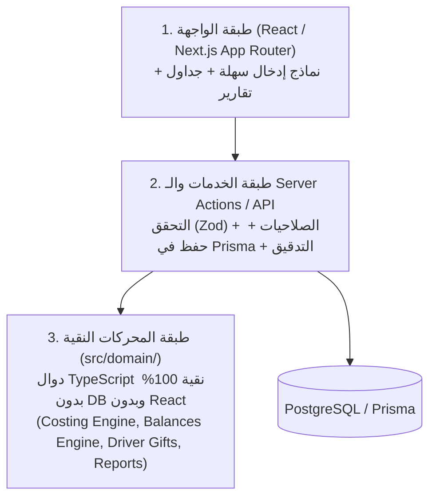

# 02 — المعمارية والتقنيات وقواعد الكود (Architecture & Tech Stack)

> **إلى الذكاء الاصطناعي المنفِّذ:** التزم بهذه التقنيات وهيكل المجلدات حرفياً. الهدف هو تقليل التعقيد إلى الحد الأدنى بحيث لا تخطئ في الربط بين الواجهة والخادم وقاعدة البيانات.

---

## 1. المكدس التقني المعتمد (Tech Stack)

اخترنا مكدساً موحداً (Monolith Full-Stack TypeScript) يعمل محلياً أو على أي خادم صغير بملف Docker واحد:

- **الإطار الأساسي (Framework):** `Next.js 14+ (App Router)` مع `TypeScript` (Strict Mode).
- **قاعدة البيانات (Database):** `PostgreSQL 16` (عبر Docker في الإنتاج والتطوير) — مع إمكانية تشغيل الاختبارات السريعة.
- **ORM:** `Prisma ORM` (يوفر أنماط TypeScript تلقائية ودعم `Decimal` ومعاملات `Transactions`).
- **الحسابات العشرية (Math):** مكتبة `decimal.js` (تُستخدم في كل حسابات المال والكميات والمتوسطات المرجحة).
- **التحقق من المدخلات (Validation):** `zod` (مخططات مشتركة بين الواجهة والخادم).
- **واجهة المستخدم (UI):**
  - `Tailwind CSS` مع دعم اتجاه العربية الأصلي (`dir="rtl"`).
  - مكونات `shadcn/ui` (Radix UI) + أيقونات `lucide-react`.
  - خط عربي واضح للأرقام والجداول: `Cairo` أو `IBM Plex Sans Arabic` مع تفعيل `tabular-nums` للأرقام.
- **الجداول والنماذج:**
  - `react-hook-form` + `@hookform/resolvers/zod` للنماذج الديناميكية (مثل الفواتير متعددة السطور `useFieldArray`).
  - `@tanstack/react-table` للجداول القابلة للفرز والفلترة.
- **الرسوم البيانية:** `recharts` (للرسم الشهري ومبيعات الفئات في الرئيسية).
- **استيراد/تصدير Excel:** `exceljs` أو `xlsx` (SheetJS).
- **المصادقة (Auth):** جلسات مبنية على الكوكيز المشفرة (`iron-session` أو `jose` JWT HttpOnly cookie) + تشفير كلمات المرور بـ `bcryptjs`. بسيط ومباشر بدون تعقيد OAuth خارجي.
- **الاختبارات (Testing):** `Vitest` لاختبارات الوحدة والتكامل (خصوصاً محرك التكلفة والسيناريو الذهبي).

---

## 2. المبدأ المعماري الأهم: فصل المحركات الحسابية النقية (`src/domain/`)

في Excel، كانت المعادلات متشابكة عبر مئات الأعمدة المساعدة (`M001_POOL_Q` .. `M036_COST_CHECK`).
في نظام الويب، **يُمنع منعاً باتاً** وضع معادلات التكلفة أو المديونية أو هدايا السائقين داخل مكونات React أو داخل استعلامات SQL معقدة يصعب تتبعها.

بدلاً من ذلك، ينقسم الكود إلى 3 طبقات واضحة:



### لماذا هذا الفصل إلزامي؟
1. يمكّنك من كتابة اختبارات `Vitest` سريعة جداً (تشتغل في أقل من ثانية) تختبر `src/domain/` مباشرة وتتحقق من أرقام عرض التدريب قبل بناء الشاشات.
2. يضمن أن نفس الدالة الحسابية تُستدعى عند التحقق قبل الحفظ، وفي شاشة الفاتورة، وفي شاشة المخزون، وفي لوحة التقارير الرئيسية — فلا يحدث تضارب أبداً بين الأرقام في الشاشات المختلفة.

---

## 3. هيكل المجلدات الإلزامي (Project Structure)

```text
oud-erp/
├── prisma/
│   ├── schema.prisma          # مخطط قاعدة البيانات الكامل (Spec 03)
│   ├── seed.ts                # بيانات التهيئة الأولية (الفئات، الوحدات، الأصول الـ 13، حساب المدير)
│   └── migrations/
├── src/
│   ├── domain/                # ⚠️ دوال نقية فقط (Pure TypeScript + decimal.js) - ممنوع استيراد prisma أو react هنا
│   │   ├── types.ts           # الأنواع المشتركة للمحركات الحسابية
│   │   ├── decimal.ts         # دوال مساعدة لـ Decimal والتقريب وتنسيق العملة
│   │   ├── period.ts          # حساب مفتاح الشهر (monthIndex) ونطاقات التواريخ
│   │   ├── costing-engine.ts  # محرك متوسط التكلفة المرجح الشهري (Spec 11)
│   │   ├── balances-engine.ts # محرك أرصدة الفواتير والأطراف والنقد والأعمار (Spec 12)
│   │   ├── driver-gifts.ts    # محرك استحقاق هدايا السائقين (Spec 13)
│   │   └── reports-engine.ts  # محرك قائمة الدخل والملخص الشهري ولوحة الرئيسية (Spec 14)
│   ├── services/              # طبقة التعامل مع قاعدة البيانات وتنفيذ العمليات
│   │   ├── ledger-loader.ts   # قراءة الحركات المعتمدة من Prisma وتحويلها لمدخلات src/domain
│   │   ├── code-generator.ts  # توليد الأكواد التلقائية (C001, P001, S000001...)
│   │   ├── audit.service.ts   # تسجيل حركات التدقيق (AuditLog)
│   │   ├── settings.service.ts
│   │   ├── master.service.ts  # الأصناف، الأطراف، الأصول، سياسة الهدايا
│   │   ├── purchase.service.ts
│   │   ├── sale.service.ts
│   │   ├── cash.service.ts
│   │   ├── return.service.ts
│   │   ├── stock-issue.service.ts
│   │   ├── batch.service.ts
│   │   ├── referral.service.ts
│   │   └── excel-import.service.ts
│   ├── validations/           # مخططات Zod لكل نموذج إدخال
│   ├── lib/
│   │   ├── db.ts              # PrismaClient singleton
│   │   ├── auth.ts            # إدارة الجلسة والصلاحيات
│   │   └── format.ts          # تنسيق الأرقام والتواريخ بالعربية
│   ├── components/
│   │   ├── ui/                # مكونات shadcn/ui الأساسية
│   │   ├── layout/            # القائمة الجانبية، شريط الفترة، شريط التنبيهات، الأزرار السريعة
│   │   ├── forms/             # مكونات الإدخال الذكية (PartySelect, ItemSelect, InvoiceSelect, MoneyInput)
│   │   └── print/             # قوالب طباعة الفاتورة وسند القبض/الصرف
│   └── app/                   # صفحات Next.js App Router
│       ├── layout.tsx         # RTL layout + الخط العربي
│       ├── login/
│       ├── setup/             # معالج التهيئة الأولية (Setup Wizard)
│       ├── (dashboard)/
│       │   ├── page.tsx       # الرئيسية والتقارير
│       │   ├── sales/         # المبيعات (قائمة + إنشاء + عرض/طباعة)
│       │   ├── purchases/     # المشتريات
│       │   ├── cash/          # الحسابات والمدفوعات (الخزينة والبنك)
│       │   ├── returns/       # المرتجعات
│       │   ├── stock-issues/  # صرف المخزون (تستر/عينات/تالف)
│       │   ├── manufacturing/ # التصنيع ومواد التصنيع
│       │   ├── drivers/       # عملاء السائقين + هدايا السائقين + سياسة الهدايا
│       │   ├── inventory/     # تقرير المخزون وكارت الصنف
│       │   ├── debts/         # تقرير المديونية وكشف حساب طرف
│       │   ├── items/         # تعريف الأصناف
│       │   ├── parties/       # الأسماء وبيانات الاتصال
│       │   ├── partners/      # الشركاء والأصول وحقوق الملكية
│       │   └── settings/      # الإعدادات، المستخدمون، سجل التدقيق، استيراد/تصدير Excel
│       └── api/               # مسارات API عند الحاجة (تصدير/استيراد/نسخ احتياطي)
└── tests/
    ├── golden-scenario.test.ts # الاختبار الشامل لمثال أكتوبر 2026 ويناير 2027 (Spec 16)
    ├── costing.test.ts
    ├── balances.test.ts
    └── driver-gifts.test.ts
```

---

## 4. قواعد الحسابات العشرية والأرقام (Decimal & Money Rules)

1. **ممنوع استخدام `number` العادي (IEEE 754 float) في جمع أو ضرب أو قسمة المبالغ أو الكميات.**
2. استخدم `Decimal` من `decimal.js` مع إعداد دقة عالية:
   ```ts
   import Decimal from 'decimal.js';
   Decimal.set({ precision: 28, rounding: Decimal.ROUND_HALF_UP });
   ```
3. **التخزين في قاعدة البيانات:**
   - المبالغ المالية (`Amount`, `Price`, `Cost`, `Value`): `Decimal(18, 4)` في Prisma.
   - الكميات (`Qty`): `Decimal(18, 4)` في Prisma (لأن العود والدهن قد يُوزن بكسور الجرام أو التولة مثل `0.5` أو `1.25`).
   - النسب المئوية (`profitShareRatio`): `Decimal(7, 4)` (مثلاً `0.6000` يمثل `60%`).
4. **هامش المقارنة الصفرية (`EPSILON`):**
   كما في صيغ Excel تماماً:
   - للمبالغ المالية: `MONEY_EPSILON = new Decimal('0.01')` (أي فرق أقل من `0.01` يُعتبر صفراً عند فحص السداد أو الرصيد الدائن).
   - للكميات: `QTY_EPSILON = new Decimal('0.000000001')` (`1e-9`).
5. **عرض الأرقام للمستخدم:**
   - المبالغ المالية بالروبية (`IDR`): تُعرض مقربة لأقرب عدد صحيح مع فواصل الآلاف `1,200,000` (أو منزلتين عشريتين إذا كانت العملة المختارة `SAR`/`AED`/`USD` أو وُجد كسر).
   - الكميات: تُعرض بدون أصفار زائدة على اليمين (مثلاً `40 جرام`، `2.5 تولة`) مع إظهار **اسم الوحدة دائماً** بجانب الرقم.
   - يجب أن تدعم حقول إدخال الأرقام كتابة الأرقام العربية (`٠١٢٣٤٥٦٧٨٩`) أو الإنجليزية (`0123456789`) وتحولها تلقائياً، وتسمح بكتابة `1000000` أو `1,000,000` مع عرض فواصل الآلاف أثناء الكتابة لمنع خطأ الصفر الزائد/الناقص في الروبية الإندونيسية.

---

## 5. قواعد التواريخ والمناطق الزمنية (Date Rules)

1. تواريخ العمليات المحاسبية (`invoiceDate`, `returnDate`, `txDate`, `issueDate`, `completionDate`, `visitDate`, `effectiveDate`, `dueDate`) هي **تواريخ تقويمية بدون وقت (`@db.Date` بصيغة `YYYY-MM-DD`)**.
2. **ممنوع** تحويل التاريخ التقويمي عبر `new Date(str).toISOString()` بطريقة تغير اليوم بسبب فرق التوقيت (Timezone shift). تعامل مع التواريخ المحاسبية كسلاسل `'YYYY-MM-DD'` أو كائنات تاريخ بتوقيت UTC ثابت `T00:00:00.000Z`.
3. حقول النظام التدقيقية فقط (`createdAt`, `updatedAt`, `voidedAt`) تكون `DateTime` كاملة بالطابع الزمني.

---

## 6. نمط الاستجابة الموحد من الخادم (Service Response Pattern)

كل دالة في `src/services/` أو `Server Action` تُرجع نتيجة موحدة لتسهيل عرض الأخطاء العربية في الواجهة:

```ts
export type ActionResult<T> =
  | { ok: true; data: T; warnings?: string[] }
  | { ok: false; error: string; fieldErrors?: Record<string, string> };
```

- `error`: رسالة خطأ عربية واضحة تمنع الحفظ (مثل: `"الكمية المرتجعة (15 جرام) تتجاوز المتبقي القابل للإرجاع من السطر الأصلي (10 جرام)"`).
- `warnings`: تنبيهات غير مانعة للحفظ إن وُجدت (مثل تنبيه اقتراب الصنف من حد إعادة الطلب).
