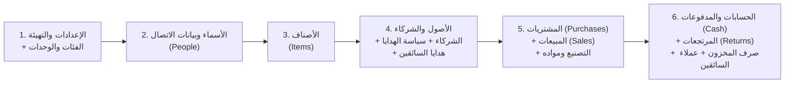

# 15 — استيراد وتصدير ملفات Excel (Excel Migration & Export)

> **إلى الذكاء الاصطناعي المنفِّذ:** يغطي هذا الملف ميزة استيراد ملف `oud_system (7).xlsx` (أو أي نسخة ممتلئة بالبيانات على نفس القالب) إلى قاعدة البيانات، وتصدير البيانات والتقارير إلى Excel.

---

## 1. الهدف من أداة الاستيراد (`/settings/import`)

صاحب المحل قد يكون قد بدأ الإدخال في ملف Excel بالفعل ويريد نقل بياناته إلى نظام الويب بضغطة زر دون إعادة كتابتها، أو يريد اختبار ملف تدريب جاهز.

---

## 2. ترتيب الاستيراد الصارم (Import Pipeline Order)

بسبب علاقات المفاتيح الأجنبية (`Foreign Keys`)، يجب أن تقرأ دالة `importWorkbook(buffer)` الأوراق بالترتيب التالي داخل `prisma.$transaction` واحدة (إذا فشل سطر جوهري، يتراجع الاستيراد بالكامل ويعرض تقرير الأخطاء):

---

## 3. خريطة قراءة الخلايا والأعمدة من `oud_system (7).xlsx`

تبدأ بيانات جميع الجداول من **الصف `6`** (العناوين في الصف `5`)، وتُتجاهل الصفوف الفارغة (التي تخلو من الاسم أو التاريخ أو المعرف):

### 3.1 ورقة `الإعدادات والتهيئة`:
- `B6`: العملة (`currencyLabel` $\leftarrow$ نستنتج `currencyCode`: `IDR` / `SAR` / `AED` / `USD`).
- `B8`: `openingCash` | `B9`: `openingBank` | `B10`: `openingReviewed` (`"نعم"` $\leftarrow$ `true`).
- `B12`: `startYear` (مثلاً `2026`).
- `D8:E19`: الفئات وبادئاتها (`ItemCategory`).
- `G8:G19`: الوحدات (`UnitOption`).

### 3.2 ورقة `الأسماء وبيانات الاتصال` (الصف `6` فما فوق):
- نتجاهل الصف إذا كان `B` (`الاسم`) فارغاً (مثل صف الاقتراح الفارغ `C002` بدون اسم).
- `A`: `code` | `B`: `name` | `C`: `type` (`عميل` $\to$ `CLIENT`, `مورد` $\to$ `SUPPLIER`, `سائق` $\to$ `DRIVER`, `شريك` $\to$ `PARTNER`, `ممول` $\to$ `FUNDER`).
- `D`: `phone` | `E`: `country` | `F`: `address` | `G`: `supplierCategory` | `H`: `carNumber`.
- `I`: `openingBalance` | `J`: `profitShareRatio`.

### 3.3 ورقة `الأصناف` (الصف `6` فما فوق):
- نتجاهل الصف إذا كان `B` (`اسم الصنف`) فارغاً.
- `A`: `code` (`P001`..) | `B`: `name` | `C`: اسم الفئة | `D`: اسم الوحدة | `E`: الدور (`بضاعة` $\to$ `MERCHANDISE`, `خام` $\to$ `RAW`, `منتج تام` $\to$ `FINISHED`).
- `F`: `reorderLevel` | `G`: `openingQty` | `H`: `openingValue` | `I`: `customCode`.

### 3.4 ورقة `الأصول والشركاء` و`الشركاء` و`سياسة الهدايا` و`هدايا السائقين`:
- في `الأصول والشركاء`:
  - الخلية `L3`: `approveOpeningAssets` (`"نعم"` $\to$ `true`).
  - الخلية `L14`: `openingLoans` | الخلية `L15`: `openingRetainedEarnings`.
  - الصفوف `6+` (الأعمدة `A:D`): `code`, `name`, `acquiredDate`, `submittedValue`.
- في `الشركاء` (الصفوف `6+`، الأعمدة `A:B`):
  - نستخرج كود الشريك من `A` (قبل `" | "`) ونحدث `Party.openingCapital` بالقيمة في `B`.
- في `سياسة الهدايا` (الصفوف `6+`، الأعمدة `A:D`):
  - إذا كانت `C` (`قيمة الهدية`) رقماً صالحاً `>= 0`، ندرج سجل `GiftPolicy(effectiveDate=A, customersPerGift=B, giftValue=C, notes=D)`.
- في `هدايا السائقين` (الصفوف `6+`، الأعمدة `A:B`):
  - نستخرج كود السائق من `A` ونحدث `Party.isDriverGiftEnabled = true` و`Party.carryoverReferrals = B`.

### 3.5 ورقة `المشتريات` (الصفوف `6+`، الأعمدة `A:J`):
- السطور التي لها نفس `(supplierId, YEAR(A) + " | " + B)` تُجمَّع تحت رأس فاتورة واحد `PurchaseInvoice`، وكل صف في Excel يصبح سطراً `PurchaseLine` بكوده الفريد في `J` (`P000001`).

### 3.6 ورقة `المبيعات` (الصفوف `6+`، الأعمدة `A:L`):
- إذا كان `I` (`نوع البند`) = `"هدية سائق"`: يُنشأ `SaleInvoice` خاص بهدية السائق وسطر `SaleLine` بنوع `DRIVER_GIFT` مع `driverId` من `J` و`driverGiftSettlementValue` من `K` وكود السطر من `L`.
- وإلا (`"بيع"` أو فارغ): السطور التي لها نفس `(customerId, YEAR(A) + " | " + B)` تُجمَّع تحت رأس فاتورة `SaleInvoice`، وكل صف يصبح `SaleLine` بكوده من `L` (`S000001`).

### 3.7 بقية أوراق الحركات:
- `التصنيع` (`A:D`) $\to$ `ProductionBatch`، ثم `مواد التصنيع` (`A:C`) $\to$ `BatchMaterial`.
- `الحسابات والمدفوعات` (`A:I`) $\to$ `CashTransaction`.
- `المرتجعات` (`A:L`) $\to$ `ReturnLine` (يربط `G` بـ `SaleLine.code` أو `PurchaseLine.code`).
- `صرف المخزون` (`A:H`) $\to$ `StockIssue`.
- `عملاء السائقين` (`A:E`) $\to$ `DriverReferral` (فقط الصفوف التي فيها التاريخ والهاتف والاسم والسائق مكتملة).

---

## 4. فحص المطابقة التلقائي بعد الاستيراد (Post-Import Reconciliation Check)

بعد استيراد أي ملف Excel، يعرض النظام **بطاقة مطابقة فورية** تقارن الأرقام المحسوبة في الويب بالأرقام المحسوبة المحفوظة في ورقة `الرئيسية والتقارير` في الملف المستورد (`B10:B17` و`J9:J11`):
- صافي المبيعات، تكلفة المبيعات، مجمل الربح، المصروفات النقدية، الربح التشغيلي، قيمة المخزون، الخزينة والبنك، مستحق العملاء، مستحق الموردين.
- إذا تطابقت جميعها `100%`، تظهر علامة خضراء: **"تم الاستيراد بنجاح وتطابقت جميع الأرصدة المحاسبية بنسبة 100%"**.
